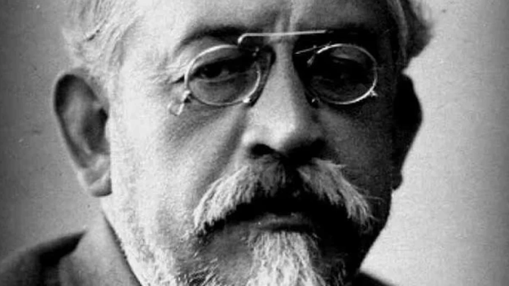

## Dönemin Ruhu
 
Yıl 1904. Osmanlı Devleti yaklaşık yüz yıldır toprak kaybediyor, savaşlar ve borçlarla boğuşuyordu. Peki bu durumdan nasıl kurtulacaktı?
 
O güne kadar bu soruya iki yöntem denenmişti ve halihazırda deneniyordu. Birincisi, devletin sınırları içindeki bütün halkları din ve soy farkı gözetmeden Osmanlı milleti adıyla birleştirmekti. İkincisi, halifelik makamının Osmanlı padişahında olmasından yararlanıp tüm dünya Müslümanlarını siyasi olarak birleştirmekti.
 
İşte tam bu ortamda, Mart 1904'te, Rusya'da yaşayan genç bir aydın kaleme sarıldı. Yazdığı makale İstanbul'da sansür yüzünden basılamayacağı için, Mısır / Kahire'de çıkan *Türk* gazetesinde yayımlandı. Makale kısa sürede büyük yankı uyandırdı. Bunun temel nedeni, Akçura’nın o güne kadar yapılmamış bir şeyi gerçekleştirmesiydi: Mevcut fikirleri objektif biçimde karşılaştırırken, yeni bir fikir olarak Türkçülüğü de ilk kez sistematik bir şekilde bu denkleme dâhil ediyordu.
 
Bu özet, makalenin ana fikirlerini ve makale etrafında dolaşan tartışmaları, sadeleştirerek anlatıyor.
 
## Birinci Yol: Osmanlıcılık
 
Bu fikir, devletin sınırları içinde yaşayan herkese aynı hakların ve aynı görevlerin verilip din ve soy farkı gözetmeyen tek bir Osmanlı milleti yaratılmasına dayanıyordu. 
 
Yusuf Akçura bu hayali, farklı kökenlerden gelen insanların aynı vatan etrafında birleştiği Amerikan milletine benzetir. Ona göre bu, yüce bir ideal olmaktan çok pratik bir hedefti: Asıl amaç, devletin mevcut sınırlarını korumaktı.
 
Fikir ilk kez ciddi biçimde II. Mahmut döneminde ortaya çıktı. Padişahın şu sözü bu anlayışı özetler: 
 
> Ben tebaamdaki din farkını ancak camilerine, havralarına ve kiliselerine girdikleri zaman görmek isterim.
 
Savunucularının elinde güçlü örnekler de vardı. Fransız milleti Kelt, Latin, Cermen gibi farklı toplulukların karışmasından doğmamış mıydı? İsviçre, içinde farklı dinler ve diller barındırdığı halde tek millet değil miydi? Öyleyse benzeri Osmanlı'da da olabilirdi.
 
> Tanzimat, Osmanlı'da 19. yüzyılda modernleşme reformlarının yapıldığı dönemdir.
 
Bu düşünce en parlak günlerini Tanzimat döneminde, Ali ve Fuad Paşalar zamanında yaşadı. Paşaların arkasındaki en büyük dış destek, Fransa İmparatoru III. Napolyon'du. Fakat 1870'te Almanya, Fransa'yı ağır bir yenilgiye uğratınca dengeler değişti: Almanların savunduğu "millet soya dayanır" anlayışı Avrupa'da güç kazandı ve Osmanlı milleti fikri en güçlü destekçisini kaybetti. Ardından Midhat Paşa aynı yolu denediyse de iktidarı kısa sürdü. Akçura'ya göre bu hayal, Fransa İmparatorluğu'yla birlikte bir daha dirilmemek üzere ölmüştü.
 
Peki bu fikir neden tutmadı? Çünkü kimse bu akımı istemiyordu. Değinilecek olursa:
 
1. Osmanlı Türkleri istemiyordu. Altı yüz yıldır devletin hakim unsuru olan Türkler, yüzyıllarca yönettikleri halklarla bir anda eşit duruma gelmeyi kabullenemiyordu.
2. Müslümanlar istemiyordu. Müslümanla gayrimüslimin hukuk önünde tam eşitliği, o günün yaygın din yorumuna aykırı görülüyordu. Dönemin hakim anlayışında İslam, mutlak hakikatin tek temsilciydi; batıl sayılan inançlarla tam bir eşitlik zemininde buluşmak dinin doğasına aykırı kabul ediliyordu.
3. Gayrimüslimler istemiyordu. Rumların, Sırpların, Bulgarların geçmişte kendi devletleri, kendi bağımsızlıkları vardı; o devletleri yıkan da Osmanlı'ydı. Milliyetçilik çağı olan 19. yüzyıl, bu halklara geçmişlerini ve haklarını yeniden hatırlattı.
4. Rusya (Osmanlı'nın en büyük düşmanı) istemiyordu. Rusya'nın gözü Osmanlı topraklarındaydı: Slavları birleştirmek, sıcak denizlere inmek, Ayasofya'ya haç dikmek istiyordu. Bütün bu planlar, Osmanlı'nın iç karışıklığına bağlıydı.
5. Avrupa kamuoyu istemiyordu. Haçlı seferlerinden kalma duygularla, Hristiyanları Müslüman yönetiminden kurtarmak ve Müslümanları Avrupa'dan atmak isteyenler vardı.
Sonuç ortadadır: Devletin başındaki birkaç yönetici, içeride hiçbir kesimin istemediği, dışarıda herkesin köstek olduğu bir projeyi Fransa'ya yaslanarak gerçekleştirmeye çalışmıştı. Proje başarısız oldu. Akçura'nın dediği gibi, artık Osmanlı milleti kurmaya uğraşmak beyhude bir yorgunluktu.
 
## İkinci Yol: İslam Birliği (Panislamizm)
 
Bu fikir, tüm dünya Müslümanlarının tek bir siyasi çatı altında toplanmasına dayanıyordu. Gayrimüslim halklar gözden çıkarılacak, karşılığında öteki Müslüman halklarla kaynaşılacaktı.
 
Akçura'ya göre bu fikir de Genç Osmanlılar'dan, bir süre önce Osmanlı milleti peşinde koşan aydın kuşağından doğdu. Meşrutiyet'le gayrimüslimlerin ayrılıkçı tavırları, Genç Osmanlılar'ın onlara ve hamileri olan Avrupa devletlerine düşman olmasına sebep oldu. Yüzlerini İslam dünyasına döndüler.
 
Sultan II. Abdülhamid, bu siyaseti devlet eliyle uygulamaya çalıştı. Padişah, "sultan" sıfatı yerine "halife" sıfatını öne çıkardı. Eğitim dini temellere oturtuldu. Saray hocalarla, imamlarla, şeyhlerle doldu; devlet görevlerine din adamları atanır oldu. Asya'da ve Afrika'da Müslüman nüfusun yoğun olduğu bölgelere elçiler gönderildi. Bu siyasetin en somut eseri ise kutsal topraklara uzanan Hicaz Demiryolu'ydu.
 
Ama bunun ağır bir bedeli vardı. Gayrimüslim tebaanın ve toprakların kaybı devleti önce zayıflatacaktı. Türklerin kendi içindeki soy kardeşliği bile Müslüman olan ve olmayan diye bölünecekti. Ve Osmanlı, Tanzimat'la terk etmeye çalıştığı din devletine geri dönüyor; düşünce özgürlüğünden, din ve ırk eşitliğinden vazgeçmek zorunda kalıyordu.
 
### Fayda
 
İslam birliği başarılırsa Asya'nın büyük kısmına ve Afrika'nın yarısından fazlasına yayılan, Avrupa devletleriyle boy ölçüşebilecek dev bir güç doğardı. Üstelik İslam'ın birleştirme gücü tarih boyunca kanıtlanmıştı. Yusuf Akçura'nın benzetmesi meşhurdur: İslam "kuvvetli bir değirmen"dir; içine giren farklı ırkları ve dinleri öğütür, geriye aynı haklara sahip, birbirinden farksız Müslümanlar çıkarır.
 
### Engeller
 
Akçura'ya göre iç engeller çözülebilir cinstendir. Ancak yönetimi altında milyonlarca Müslüman yaşayan İngiltere, Fransa ve Rusya gibi devletler, kendi tebaalarının sınırların ötesindeki bir siyasi merkeze bağlanmasına asla göz yummazdı.
 
## Üçüncü Yol: Türk Birliği (Pantürkizm)
 
Bu fikir, dünyadaki bütün Türkleri soy birliği temelinde birleştirmeye dayanıyordu.
 
Yusuf Akçura bu fikrin 1904 yılı için ne kadar taze olduğunun özellikle altını çizer. Ona göre tarihte hiçbir Türk devleti böyle bir amaç gütmemiştir. Tanzimat'ta da, Genç Osmanlılar'da da bu fikrin izine rastlanmaz. Yazara göre düşüncenin doğuşunda Osmanlı-Almanya yakınlaşmasının, yani soya dayalı Alman milliyetçiliğiyle tanışmanın payı vardır.
 
Akçura'ya göre bu fikir Rusya Türkleri arasında yeni yeni filizlenmektedir. Kendi deyişiyle ırka dayalı siyasi millet fikri henüz "pek turfandadır"; mevsimi gelmemiş meyve gibi çok yenidir.
 
### Fayda

Osmanlı'daki Türkler hem din hem soy bağıyla, yani çifte bağla kenetlenirdi. Türkleşmeye yatkın topluluklar bu kimliği daha kolay benimserdi. Ve en önemlisi: Asya'ya ve Doğu Avrupa'ya yayılmış milyonlarca Türk'ün birleşmesiyle dev bir siyasi millet doğabilirdi. Bedeli ise açıktı: Müslüman olduğu halde Türk olmayan ve Türkleştirilemeyecek halklar, örneğin Araplar, Osmanlı'dan kopardı.
 
### Engeller
 
İç engeller çok büyüktü; çünkü Türklük fikri Akçura'nın deyişiyle "yeni doğmuş bir çocuk"tu. İslam'ın asırlık teşkilatı, coşkusu ve birleştirici kurumları Türklükte henüz yoktu; Türkler geçmişlerini ve geleneklerini büyük ölçüde unutmuştu. Yazarın burada dikkat çekici bir önerisi vardır: Türklerin büyük çoğunluğu Müslüman olduğuna göre, İslam büyük Türk milletinin kuruluşunda önemli bir harç olabilir. Ama bunun için dinin, son dönemde Hristiyanlıkta olduğu gibi, içinde milliyetlerin doğmasını kabul edecek şekilde değişmesi gerekir: Din, toplum işlerini düzenleyen bir güç olmaktan çıkıp "kalplerin rehberi" haline gelmeliydi.
 
Dış engellerse şaşırtıcı derecede azdı. Müslüman Türk tebaası olan tek büyük Hristiyan devlet Rusya'ydı; birleşmeye köstek olacak tek güç oydu. Hatta Akçura, Rusya'yla arası bozuk olan Avrupa devletleri'nin bu işe destek bile verebileceğini düşünür.
 
## Peki Hangisi Faydalıydı?
 
Yusuf Akçura bu üç fikri duygusallıktan uzak bir biçimde tartar. Ona göre Osmanlı'nın güçlenmesi bütün Müslümanların ve Türklerin de işine gelirdi; ancak İslam birliği de Türk birliği de devleti kısa vadede zayıflatırdı.
 
Osmanlıcılık, devletin o günkü sınırlarını korumanın tek yoluydu; bu yüzden faydalıydı ama uygulanması mümkün değildi. Nedenlerini yukarıda saymıştık. Üstelik Abdülhamid'in İslamcı siyaseti Müslümanlarla gayrimüslimlerin arasını iyice açmış, Osmanlıcılığın en büyük destekçisi Fransa da Rusya'nın müttefiki olunca bu kapı kapanmıştır.
 
Geriye iki yol kalır: İslam birliği ve Türk birliği. Akçura'nın ulaştığı sonuç şudur: İkisinin de faydaları ve sakıncaları aşağı yukarı denktir; uygulama zorlukları da öyle. İslamcılıkta iç engeller az, dış engeller büyüktür; Türkçülükte iç engeller büyük, dış engeller azdır.
 
Yazar bir sitem de ekler. Makaleyi yayımlayan gazetenin adını, *Türk*'ü duyunca cevabı orada bulacağını ummuştur. Ama görür ki gazetenin "Türk"ü, Anadolu ve Asya'ya yayılan büyük ırkın tamamı değil, yalnızca Osmanlı sınırları içindeki Batı Türküdür: Gazetenin saydığı büyükler Fatihlerden, Bakilerden öteye, Oğuzlara, Cengizlere, Uluğ Beylere, Farabilere, İbn Sinalara uzanmaz. Üstelik gazete, İslamcılık ile Türkçülüğü aynı anda destekleyerek iki arada kalmıştır.
 
Ve makale, herkesi şaşırtan o hamleyle biter: Akçura kazananı ilan etmez. Zihnini uzun süredir meşgul eden soruyu ortaya bırakır: "Müslümanlık ve Türklük siyasetlerinden hangisi Osmanlı Devleti için daha faydalı ve uygulanabilirdir?"
 
Bu açık uçlu son, makalenin kaderini belirledi. Cevaplanmamış bir soru, cevap vermek isteyen herkesi tartışmaya çekti.
 
## Makale Üzerine Tartışmalar
 
Makaleye cevaplar gecikmez. Kitabın bugünkü baskılarında Akçura'nın makalesiyle birlikte iki ünlü cevap da yer alır.
 
### Ali Kemal'in cevabı: "Üçü de boş hayal"
 
*Türk* gazetesi yazarlarından Ali Kemal'in "Cevabımız" başlıklı yazısı, tartışmanın zeminini kökten reddeder. Ona göre Türk'ü İslam'dan, İslam'ı Türk'ten, ikisini Osmanlılıktan ayırmak imkansızdır; bu üçü iç içedir ve aralarında seçim yapılamaz.
 
Ali Kemal'e göre Akçura tarihi de yanlış okumaktadır. Hiçbir padişah, hiçbir vezir bu üç ülküden birine kendini adamamıştır. Tanzimat paşaları Bulgar'ı, Rum'u, Ermeni'yi "Osmanlı milleti" kalıbına sokma hayaline kapılmamış, sadece bu halkları devlete bağlı tutmaya çalışmıştır; bu da gayet makuldür.
 
Ardından üç fikri tek tek vurur. İslam birliği mi? Bunun için dünyanın Müslümanlarına hükmeden İngiltere'ye, Fransa'ya, Rusya'ya aynı anda meydan okuyabilecek güçte olmak gerekir. Oysa "biz Rumeli'nin Müslümanlarını bile koruyamıyoruz"; Hindistan'ınkileri etkilemeye kalkışmak hayale bile sığmaz. Ruslar Slavları, Almanlar Cermenleri birleştirmeye çalışabilir; çünkü aralarında din dışında soy, dil ve coğrafya bağları vardır. Müslümanların ise dinden başka ortak nesi vardır? Türk birliği mi? Bunun için dünyayı altüst etmek, "koca Rusya'yı gövdesinden kırmak" gerekir. Türklerle dolu Kırım'ı bile elimizde tutamamışken Asya'nın Türklerini birleştirmeye kalkışmak da hayaldir.
 
#### Önerisi
 
Büyük siyasi ülküleri şimdilik rafa kaldırmak gerektiğini düşünür. Türk milleti köklü ve yetenekli bir kavimdir; bugünkü kötü hal kavmin özünden değil, zamanın şartlarındandır. Öyleyse önce fertler kendini yetiştirsin: meslek, bilgi ve erdem sahibi olsun. Türkler yok olma tehlikesinden kurtulup ayağa kalksın; Osmanlıcılık mı, İslam birliği mi, Türk birliği mi sorusunu ondan sonra tartışsınlar.
 
### Ahmed Ferid'in cevabı: "Bugün Osmanlıcılık ve yanında İslam, gelecekte Türklük"
 
> Yazar, Cumhuriyet'le birlikte "Tek" soyadını alan ve Yusuf Akçura'nın yakın dostu olan Ahmet Ferit Tek'tir.
 
Haziran 1904'te Mısır'dan gönderilen bir mektupla Ahmed Ferid tartışmaya katılır. Ona göre *Üç Tarz-ı Siyaset* kesinlikle tartışılmaya değer bir metindir; ama önce Ali Kemal'i düzeltmek ister.
 
"Kimse bu siyasetleri gütmedi" demek, devletin en seçkin adamlarını plansızlıkla suçlamaktır. Türkçülük yenidir, evet, onu kimse gütmemiştir; ama İslam birliği bizzat Abdülhamid'in siyasetidir. Padişahın dünya Müslümanlarının dikkatini çekmeye çalışması, Hicaz'ın korunmasını Anadolu'ya öncelemesi, okul programlarını din dersleriyle doldurması bunun kanıtıdır. Osmanlı milleti kurmak da Tanzimat devlet adamlarının açık hedefiydi: Kanun-i Esasi'nin (ilk Osmanlı anayasası) 8. maddesi bütün tebaayı dinine bakılmaksızın "Osmanlı" sayar; 18. maddesi devlet memurluğu için Türkçe bilme şartı getirir. Ferid'e göre Tanzimat'ın bu projesi bir "temsil", yani hakim milletin öteki halkları dil ve kültürde kendine benzetmesi çabasıdır; din yoluyla benzetme çağı geçmiştir, asıl araç artık dildir. Hatta Ferid, direnen halklar çıkarsa onları göçe teşvikten başka çare kalmayacağını söyleyecek kadar ileri gider. Ali Kemal'in atladığı nokta ise şudur: Bu birlik ülküleri illa savaş gerektirmez; fikir yoluyla, zihinlerde yürütülür.
 
"Önce fertler yükselsin" görüşüne de itiraz eder: Fertler kendini geliştirirken devlet gemisini rotasız ve hedefsiz bırakmak doğru mudur?
 
#### Önerisi
 
Ahmed Ferid'in kendi cevabı üçlü bir formüldür. Osmanlıcılık, gelecekte parlak sonuçlar vaat etmese de bugün izlenmesi en kolay ve en faydalı siyasettir; asıl rota bu olmalıdır. İslam birliği, hedef olarak gerçekleşmesi zor, hatta belki hiç mümkün olmayacak bir düştür; ama din hala toplumların en canlı gücüdür ve İslam'ın bu gücünden bugünden yararlanmak devlet için çok değerlidir. Türk birliği ise gelecek olarak en güçlü ihtimaldir; dünyaya yayılmış otuz-otuz beş milyonluk bir kavimden ileride büyük bir devlet beklemek hayal değildir. Fakat bugün ortada böyle bir birlik yoktur ve "mevcut olmayan şeyden istifade edilemez". Kısacası öbür iki fikir, ana rotanın yardımcılarıdır. Ferid'e göre Akçura'yı yanıltan şey, gerçeklikten çok mantık ve felsefe kesinliği araması, ahvali (yani mevcut şartları) dikkate almamasıdır.
 
Mektup, yazarının siyasette altın kural saydığı bir düşünceyle biter: Siyasi işlerde fırsatları kollamaktan daha doğru, daha faydalı bir yol var mıdır?
 
## Değerlendirme
 
*Üç Tarz-ı Siyaset*'in sorduğu soruya cevabı sonunda tarih verdi. Makaleden sonraki yirmi yıl içinde Balkan Savaşları ve Birinci Dünya Savaşı yaşandı, imparatorluk dağıldı ve yeni devlet üç yoldan üçüncüsüne, millî kimliğe yaslanarak kuruldu. Bu yüzden Yusuf Akçura'nın makalesi bugün çoğunlukla "Türkçülüğün manifestosu" olarak anılır. Ahmet Ferit Tek, Yusuf Akçura'nın cevapsız bıraktığı soruyu günün şartlarına göre keskin bir doğrulukla öngördü. İkisi de bu yeni devletin kadroları arasında yerlerini aldı.
 
Peki yüz yılı aşkın süredir bu kısa metin neden hala okunuyor? Çünkü Akçura bir ideolojinin propagandasını yapmıyor; herkesin duygularla tartıştığı bir konuyu fayda, zarar ve uygulanabilirlik sorularıyla, tarafsız bir netlikle ele alıyor. Okura fikirleri savunmayı değil, tartmayı öğretiyor.
 
Makalenin düşündüren bir yan etkisi de var. Ona yöneltilen eleştirilerden biri şuydu: Biz zaten aynı anda hem Osmanlı, hem Müslüman, hem Türk değil miydik; neden birini seçmek zorunda olalım? Gerçekten de sonraki dönemlerde tuhaf bir alışkanlık yerleşti. İslamcılık siyaseti terk edilince sanki Müslümanlık da terk edilecekmiş gibi davranıldı; Türkçülükten vazgeçilince Türk kimliği başka nitelikler üzerine kurulmaya çalışıldı; Osmanlıcılık bitince de Osmanlı'ya dair ne varsa kötülemek adet oldu. Oysa bir siyaseti bırakmak, o kimliği bırakmayı gerektirmiyordu.
 
Makalenin üzerinden 120 yılı aşkın zaman geçti; meclisimizde Türk milleti kavramı üzerinden tartışmalar tüm harareti ve ihanetiyle sürüyor. Osmanlıcılık hevesi AKP hükümetiyle birlikte yeniden canlandırılmaya çalışılması "beyhude bir ihanet" olmaktan ileri gidemiyor. 
